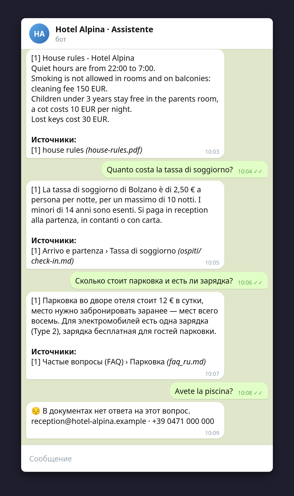
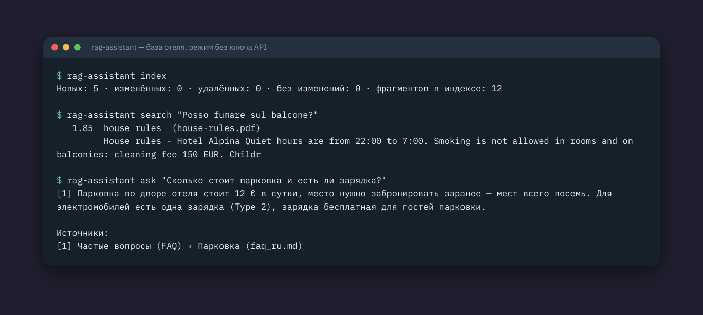

# 📚 RAG Assistant

<p>
  <a href="https://github.com/sonoyumi/rag-assistant/actions/workflows/ci.yml"></a>
  
  
  
  
  
</p>

**🇬🇧 [English](#en)** · **🇮🇹 [Italiano](#it)** · **🇺🇦 [Українська](#uk)** · **🇷🇺 [Русский](#ru)**

<p align="center">
  
  
</p>

---

<a name="en"></a>

## 🇬🇧 English

A knowledge-base assistant for a company: put your documents in a folder (FAQ, price lists, rules, manuals)
and customers or staff ask questions in Telegram or in the terminal. Answers come **only from those documents**,
every statement is marked with a source, and if the documents do not say it, the assistant says so instead of guessing.

```
documents ──index──► SQLite FTS5 (BM25) ──top passages──► Claude API (citations) ──► answer [1][2] + sources
 .md .txt .html .pdf        incremental                        │ no API key / API down
                                                               └──────────► best passages with sources
```

### Features

- **Documents:** Markdown, plain text, HTML (scripts dropped, headings kept) and PDF with a text layer; subfolders are read,
  folders starting with `_` or `.` (drafts) are skipped. Indexing is **incremental**: unchanged files are skipped by SHA-256,
  deleted files leave the index, a broken file is reported without stopping the rest.
- **Chunks know their section:** Markdown is split by headings first, so a passage is labelled `FAQ › Parking`;
  long sections are split by paragraphs with overlap.
- **Search without a vector database:** SQLite FTS5 with BM25 ranking, section titles weighted double, accents ignored
  (`citta` finds `città`), prefix matching as a cheap multilingual stemmer (`парковки` finds `парковка`), hyphenated words
  as phrases (`Wi-Fi`). The user's text can never inject FTS syntax: every term is quoted.
- **Grounded answers with citations:** each passage goes to Claude as a separate document with the Citations API enabled;
  the answer comes back with `[1]`, `[2]` markers that point to real files. Sources the model did not send are never shown.
- **Honest "I don't know":** no relevant passage, no API call; the bot offers your contact instead.
- **Resilient:** without an API key, or when the API fails, the assistant returns the most relevant passages with sources.
  Refusals and server-side fallbacks are handled.
- **Telegram bot:** private chats only, optional list of allowed users (internal knowledge base), questions-per-hour limit
  per user to protect the budget, admin commands `/reindex` and `/stats`, long answers split for Telegram.
- **CLI:** `index`, `search` (free, shows what the AI would get), `ask`, `stats`, `bot`.

### Example

Example knowledge base in [`examples/kb`](examples/kb): a fictional hotel in Bolzano, documents in Italian, Russian and
English, in Markdown, TXT, HTML and PDF.

```bash
rag-assistant index
rag-assistant ask "Сколько стоит парковка и есть ли зарядка?"          # without an API key: passages
```

```
Новых: 5 · изменённых: 0 · удалённых: 0 · без изменений: 0 · фрагментов в индексе: 12
[1] Парковка во дворе отеля стоит 12 € в сутки, место нужно забронировать заранее — мест всего восемь. Для электромобилей есть одна зарядка (Type 2), зарядка бесплатная для гостей парковки.

Источники:
[1] Частые вопросы (FAQ) › Парковка (faq_ru.md)
```

The question and the document are in Russian: "How much is parking, is there a charger?" → the parking paragraph
(12 € a day, one Type 2 charger, free for parking guests) with its source. With `ANTHROPIC_API_KEY` set, Claude writes
a short answer in the language of the question with `[1]` markers pointing to the same sources.

### Quick start

```bash
git clone https://github.com/sonoyumi/rag-assistant.git
cd rag-assistant
python3 -m venv .venv && source .venv/bin/activate
pip install -e ".[dev]"
cp .env.example .env              # KB_DIR, ANTHROPIC_API_KEY (optional), BOT_TOKEN (for the bot)
rag-assistant index && rag-assistant ask "Can I smoke on the balcony?"
```

Tests: `pytest` (42 tests: loaders including PDF, chunking, search in four languages, incremental indexing, citations →
sources, API errors and fallback to passages, the bot through the real aiogram Dispatcher, CLI, settings).
No API key or network is needed for the tests.

### Project structure

```
src/rag_assistant/
├── loaders.py    # .md .txt .html .pdf -> text + title
├── chunker.py    # split by headings and paragraphs, with overlap
├── index.py      # SQLite FTS5 index: incremental indexing, BM25 search, safe queries
├── answer.py     # Claude with citations; extractive answers; sources
├── assistant.py  # search + answer, fallback to passages if the AI fails
├── bot.py        # Telegram bot: access list, rate limit, admin commands
├── ratelimit.py  # questions per hour per user
├── texts.py      # bot texts, HTML/terminal formatting, splitting long messages
├── config.py     # settings from .env
└── cli.py        # rag-assistant index | search | ask | stats | bot
```

### Author

**Vladyslav Shokun** ([@sonoyumi](https://github.com/sonoyumi)), Python developer: Telegram bots, web scraping, automation.

[](https://t.me/sonoyumiii)
[](mailto:sonoyumiii@gmail.com)
[](https://www.linkedin.com/in/vladyslav-shokun/)

> 💼 Your team answers the same questions every day? Get in touch, I'll turn your documents into an assistant.

### License

MIT, see [LICENSE](LICENSE).

---

<a name="it"></a>

## 🇮🇹 Italiano

**[🇬🇧 English](#en)** · **🇮🇹 Italiano** · **[🇺🇦 Українська](#uk)** · **[🇷🇺 Русский](#ru)**

Un assistente per la base di conoscenza di un'azienda: mettete i vostri documenti in una cartella (FAQ, listini, regolamenti,
manuali) e clienti o dipendenti fanno domande su Telegram o dal terminale. Le risposte vengono **solo da quei documenti**,
ogni affermazione indica la fonte e, se i documenti non lo dicono, l'assistente lo ammette invece di inventare.

### Funzionalità

- **Documenti:** Markdown, testo, HTML (script rimossi, titoli conservati) e PDF con testo; le sottocartelle vengono lette,
  quelle che iniziano con `_` o `.` (bozze) vengono saltate. L'indicizzazione è **incrementale**: i file invariati vengono
  saltati grazie allo SHA-256, quelli eliminati escono dall'indice, un file rovinato viene segnalato senza fermare gli altri.
- **I frammenti conoscono la loro sezione:** il Markdown viene diviso prima per titoli, così un passaggio è etichettato
  `FAQ › Parcheggio`; le sezioni lunghe vengono divise per paragrafi con sovrapposizione.
- **Ricerca senza database vettoriale:** SQLite FTS5 con ranking BM25, titoli di sezione con peso doppio, accenti ignorati
  (`citta` trova `città`), ricerca per prefisso come stemmer multilingue economico (`prezzi` trova `prezzo`), parole con
  trattino come frasi (`Wi-Fi`). Il testo dell'utente non può iniettare sintassi FTS: ogni termine è tra virgolette.
- **Risposte fondate con citazioni:** ogni passaggio va a Claude come documento separato con la Citations API attiva;
  la risposta torna con i rimandi `[1]`, `[2]` ai file reali. Le fonti non inviate non vengono mai mostrate.
- **Un «non lo so» onesto:** nessun passaggio pertinente, nessuna chiamata all'API; il bot propone il vostro contatto.
- **Robusto:** senza chiave API, o se l'API non risponde, l'assistente restituisce i passaggi più pertinenti con le fonti.
  Rifiuti e fallback lato server sono gestiti.
- **Bot Telegram:** solo chat private, elenco facoltativo di utenti ammessi (base interna), limite di domande all'ora per
  utente per proteggere il budget, comandi admin `/reindex` e `/stats`, risposte lunghe divise per Telegram.
- **CLI:** `index`, `search` (gratis, mostra cosa riceverebbe l'IA), `ask`, `stats`, `bot`.

### Esempio

La base di esempio in [`examples/kb`](examples/kb) è un hotel immaginario a Bolzano, con documenti in italiano, russo e
inglese, in Markdown, TXT, HTML e PDF. L'output è nella sezione inglese: alla domanda in russo «Quanto costa il parcheggio,
c'è una colonnina?» risponde il paragrafo sul parcheggio (12 € al giorno, una colonnina Type 2 gratuita) con la sua fonte.
Con `ANTHROPIC_API_KEY` Claude scrive una risposta breve nella lingua della domanda con i rimandi `[1]`.

### Avvio rapido

```bash
git clone https://github.com/sonoyumi/rag-assistant.git
cd rag-assistant
python3 -m venv .venv && source .venv/bin/activate
pip install -e ".[dev]"
cp .env.example .env              # KB_DIR, ANTHROPIC_API_KEY (facoltativa), BOT_TOKEN (per il bot)
rag-assistant index && rag-assistant ask "Quanto costa la tassa di soggiorno?"
```

Test: `pytest` (42 test: lettura dei file incluso il PDF, suddivisione, ricerca in quattro lingue, indicizzazione
incrementale, citazioni → fonti, errori dell'API e ritorno ai passaggi, il bot con il vero Dispatcher di aiogram, CLI,
impostazioni). Per i test non servono né la chiave API né la rete.

### Struttura del progetto

```
src/rag_assistant/
├── loaders.py    # .md .txt .html .pdf -> testo + titolo
├── chunker.py    # divisione per titoli e paragrafi, con sovrapposizione
├── index.py      # indice SQLite FTS5: indicizzazione incrementale, ricerca BM25, query sicure
├── answer.py     # Claude con citazioni; risposte estrattive; fonti
├── assistant.py  # ricerca + risposta, ritorno ai passaggi se l'IA non risponde
├── bot.py        # bot Telegram: elenco di accesso, limite di domande, comandi admin
├── ratelimit.py  # domande all'ora per utente
├── texts.py      # testi del bot, formattazione HTML/terminale, divisione dei messaggi lunghi
├── config.py     # impostazioni da .env
└── cli.py        # rag-assistant index | search | ask | stats | bot
```

### Autore

**Vladyslav Shokun** ([@sonoyumi](https://github.com/sonoyumi)), sviluppatore Python: bot Telegram, web scraping, automazione.

[](https://t.me/sonoyumiii)
[](mailto:sonoyumiii@gmail.com)
[](https://www.linkedin.com/in/vladyslav-shokun/)

> 💼 Il vostro team risponde ogni giorno alle stesse domande? Scrivetemi, trasformo i vostri documenti in un assistente.

### Licenza

MIT, vedi [LICENSE](LICENSE).

---

<a name="uk"></a>

## 🇺🇦 Українська

**[🇬🇧 English](#en)** · **[🇮🇹 Italiano](#it)** · **🇺🇦 Українська** · **[🇷🇺 Русский](#ru)**

Асистент з базою знань компанії: кладете документи в папку (FAQ, прайси, правила, інструкції), а клієнти чи працівники
ставлять запитання в Telegram або в терміналі. Відповіді беруться **лише з цих документів**, кожне твердження має джерело,
а якщо в документах цього немає — асистент так і каже, замість вигадувати.

### Можливості

- **Документи:** Markdown, текст, HTML (скрипти прибираються, заголовки зберігаються) і PDF із текстовим шаром; підпапки
  читаються, папки на `_` або `.` (чернетки) пропускаються. Індексація **інкрементальна**: незмінені файли пропускаються
  за SHA-256, видалені зникають з індексу, зламаний файл потрапляє у звіт, не зупиняючи інші.
- **Фрагменти знають свій розділ:** Markdown спершу ділиться за заголовками, тож фрагмент підписаний `FAQ › Парковка`;
  довгі розділи діляться за абзацами з перекриттям.
- **Пошук без векторної бази:** SQLite FTS5 з ранжуванням BM25, заголовки розділів мають подвійну вагу, наголоси
  ігноруються (`citta` знаходить `città`), пошук за початком слова як дешевий багатомовний стемер (`парковки` знаходить
  `парковка`), слова через дефіс — як фрази (`Wi-Fi`). Текст користувача не може підставити синтаксис FTS: кожне слово в лапках.
- **Обґрунтовані відповіді з цитатами:** кожен фрагмент іде в Claude окремим документом з увімкненим Citations API;
  відповідь повертається з позначками `[1]`, `[2]`, що ведуть на справжні файли. Джерела, яких ми не надсилали, не показуються.
- **Чесне «не знаю»:** немає доречного фрагмента — немає запиту до API; бот пропонує ваш контакт.
- **Стійкість:** без ключа API або коли API не відповідає, асистент повертає найдоречніші фрагменти з джерелами.
  Відмови та резервні моделі на боці сервера обробляються.
- **Telegram-бот:** лише особисті чати, за бажанням — список дозволених користувачів (внутрішня база), ліміт запитань
  на годину на людину для захисту бюджету, команди адміністратора `/reindex` і `/stats`, довгі відповіді діляться на частини.
- **CLI:** `index`, `search` (безкоштовно, показує, що отримав би ШІ), `ask`, `stats`, `bot`.

### Приклад

Приклад бази знань у [`examples/kb`](examples/kb) — вигаданий готель у Больцано, документи італійською, російською
й англійською у Markdown, TXT, HTML і PDF. Вивід — в англійському розділі: на запитання російською «Скільки коштує
парковка і чи є зарядка?» приходить абзац про парковку (12 € на добу, одна зарядка Type 2, безкоштовна) з джерелом.
З `ANTHROPIC_API_KEY` Claude пише коротку відповідь мовою запитання з позначками `[1]`.

### Швидкий старт

```bash
git clone https://github.com/sonoyumi/rag-assistant.git
cd rag-assistant
python3 -m venv .venv && source .venv/bin/activate
pip install -e ".[dev]"
cp .env.example .env              # KB_DIR, ANTHROPIC_API_KEY (за бажанням), BOT_TOKEN (для бота)
rag-assistant index && rag-assistant ask "Скільки коштує парковка?"
```

Тести: `pytest` (42 тести: читання файлів разом із PDF, поділ на фрагменти, пошук чотирма мовами, інкрементальна
індексація, цитати → джерела, помилки API й повернення до фрагментів, бот через справжній Dispatcher aiogram, CLI,
налаштування). Для тестів не потрібні ні ключ API, ні мережа.

### Структура проєкту

```
src/rag_assistant/
├── loaders.py    # .md .txt .html .pdf -> текст + заголовок
├── chunker.py    # поділ за заголовками й абзацами, з перекриттям
├── index.py      # індекс SQLite FTS5: інкрементальна індексація, пошук BM25, безпечні запити
├── answer.py     # Claude з цитатами; відповіді фрагментами; джерела
├── assistant.py  # пошук + відповідь, повернення до фрагментів, якщо ШІ не відповідає
├── bot.py        # Telegram-бот: список доступу, ліміт запитань, команди адміністратора
├── ratelimit.py  # запитань на годину на користувача
├── texts.py      # тексти бота, форматування HTML/термінал, поділ довгих повідомлень
├── config.py     # налаштування з .env
└── cli.py        # rag-assistant index | search | ask | stats | bot
```

### Автор

**Vladyslav Shokun** ([@sonoyumi](https://github.com/sonoyumi)) — Python-розробник: Telegram-боти, парсинг, автоматизація.

[](https://t.me/sonoyumiii)
[](mailto:sonoyumiii@gmail.com)
[](https://www.linkedin.com/in/vladyslav-shokun/)

> 💼 Ваша команда щодня відповідає на ті самі запитання? Напишіть мені, перетворю ваші документи на асистента.

### Ліцензія

MIT — див. [LICENSE](LICENSE).

---

<a name="ru"></a>

## 🇷🇺 Русский

**[🇬🇧 English](#en)** · **[🇮🇹 Italiano](#it)** · **[🇺🇦 Українська](#uk)** · **🇷🇺 Русский**

Ассистент с базой знаний компании: кладёте документы в папку (FAQ, прайсы, правила, инструкции), а клиенты или сотрудники
задают вопросы в Telegram или в терминале. Ответы берутся **только из этих документов**, у каждого утверждения есть источник,
а если в документах этого нет — ассистент так и говорит, вместо того чтобы выдумывать.

### Возможности

- **Документы:** Markdown, текст, HTML (скрипты убираются, заголовки сохраняются) и PDF с текстовым слоем; подпапки
  читаются, папки на `_` или `.` (черновики) пропускаются. Индексация **инкрементальная**: неизменённые файлы пропускаются
  по SHA-256, удалённые исчезают из индекса, битый файл попадает в отчёт, не останавливая остальные.
- **Фрагменты знают свой раздел:** Markdown сначала делится по заголовкам, поэтому фрагмент подписан `FAQ › Парковка`;
  длинные разделы делятся по абзацам с перекрытием.
- **Поиск без векторной базы:** SQLite FTS5 с ранжированием BM25, заголовки разделов весят вдвое больше, ударения и акценты
  игнорируются (`citta` находит `città`), поиск по началу слова как дешёвый многоязычный стеммер (`парковки` находит
  `парковка`), слова через дефис — как фразы (`Wi-Fi`). Текст пользователя не может подставить синтаксис FTS: каждое слово в кавычках.
- **Обоснованные ответы с цитатами:** каждый фрагмент уходит в Claude отдельным документом с включённым Citations API;
  ответ возвращается с пометками `[1]`, `[2]`, ведущими на настоящие файлы. Источники, которых мы не отправляли, не показываются.
- **Честное «не знаю»:** нет подходящего фрагмента — нет запроса к API; бот предлагает ваш контакт.
- **Устойчивость:** без ключа API или когда API не отвечает, ассистент возвращает самые подходящие фрагменты с источниками.
  Отказы и резервные модели на стороне сервера обрабатываются.
- **Telegram-бот:** только личные чаты, по желанию — список допущенных пользователей (внутренняя база), лимит вопросов
  в час на человека для защиты бюджета, команды администратора `/reindex` и `/stats`, длинные ответы делятся на части.
- **CLI:** `index`, `search` (бесплатно, показывает, что получил бы ИИ), `ask`, `stats`, `bot`.

### Пример

Пример базы знаний в [`examples/kb`](examples/kb) — вымышленный отель в Больцано, документы на итальянском, русском
и английском в Markdown, TXT, HTML и PDF. Вывод — в английском разделе выше. С `ANTHROPIC_API_KEY` Claude пишет короткий
ответ на языке вопроса с пометками `[1]`, ведущими на те же источники.

### Быстрый старт

```bash
git clone https://github.com/sonoyumi/rag-assistant.git
cd rag-assistant
python3 -m venv .venv && source .venv/bin/activate
pip install -e ".[dev]"
cp .env.example .env              # KB_DIR, ANTHROPIC_API_KEY (по желанию), BOT_TOKEN (для бота)
rag-assistant index && rag-assistant ask "Сколько стоит парковка?"
```

Тесты: `pytest` (42 теста: чтение файлов вместе с PDF, деление на фрагменты, поиск на четырёх языках, инкрементальная
индексация, цитаты → источники, ошибки API и возврат к фрагментам, бот через настоящий Dispatcher aiogram, CLI,
настройки). Для тестов не нужны ни ключ API, ни сеть.

### Структура проекта

```
src/rag_assistant/
├── loaders.py    # .md .txt .html .pdf -> текст + заголовок
├── chunker.py    # деление по заголовкам и абзацам, с перекрытием
├── index.py      # индекс SQLite FTS5: инкрементальная индексация, поиск BM25, безопасные запросы
├── answer.py     # Claude с цитатами; ответы фрагментами; источники
├── assistant.py  # поиск + ответ, возврат к фрагментам, если ИИ не отвечает
├── bot.py        # Telegram-бот: список доступа, лимит вопросов, команды администратора
├── ratelimit.py  # вопросов в час на пользователя
├── texts.py      # тексты бота, форматирование HTML/терминал, деление длинных сообщений
├── config.py     # настройки из .env
└── cli.py        # rag-assistant index | search | ask | stats | bot
```

### Автор

**Vladyslav Shokun** ([@sonoyumi](https://github.com/sonoyumi)) — Python-разработчик: Telegram-боты, парсинг, автоматизация.

[](https://t.me/sonoyumiii)
[](mailto:sonoyumiii@gmail.com)
[](https://www.linkedin.com/in/vladyslav-shokun/)

> 💼 Ваша команда каждый день отвечает на одни и те же вопросы? Напишите мне, превращу ваши документы в ассистента.

### Лицензия

MIT — см. [LICENSE](LICENSE).
